# Beethoven Craft

Compositor de video y audio en español (y en inglés), hecho en Rust. Son dos programas en una app:

- **Beethoven Movie**: editor de video con animación, nodos, filtros y mezcla de sonido.
- **Beethoven DAW**: estudio de música con Playlist, Mixer, unos 195 instrumentos grabados, efectos en Lua y plugins VST3/CLAP.

Creado por **mixter-ha99**. Software libre, MIT o Apache-2.0.

> *English: a free video editor (Beethoven Movie) and music studio (Beethoven DAW) in one app, written in Rust. The interface is available in Spanish and English. Docs are in Spanish for now.*

**Descargar:** [ismael-kaiser.github.io/beethoven-craft](https://ismael-kaiser.github.io/beethoven-craft/) · [todas las versiones](https://github.com/Ismael-kaiser/beethoven-craft/releases)


## Novedades de la 0.12.6

**Exportar para Discord.** Un ajuste listo que hace que el video no pase de 10 MB (o el peso que elijas: 25 MB, Nitro Basic 50 MB…). Se ajustan solos la calidad, el tamaño y los cuadros, con dos pasadas de H.264.

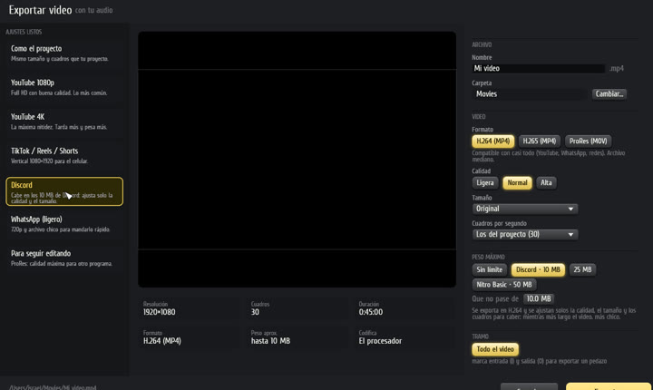

## Novedades de la 0.12.5: Movie y el DAW, juntos

**Los plugins del DAW en Movie**, con la misma ventana y el mismo motor: suenan igual al reproducir y al exportar.

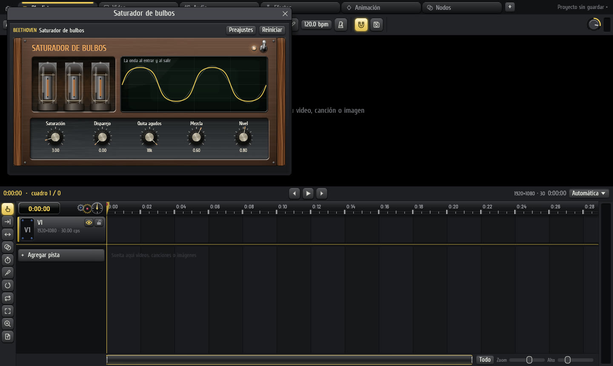

| Velocidad en el clic derecho (−50 % es cámara lenta) | Transiciones propias en el catálogo |
|---|---|
| 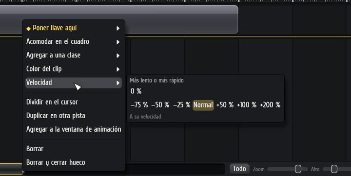 | 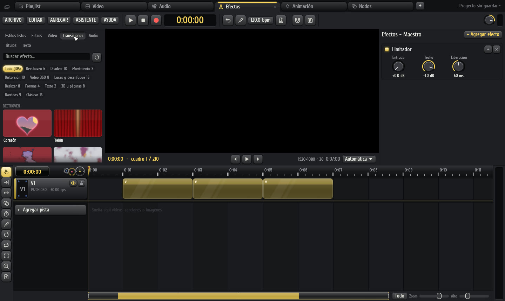 |

**Seis transiciones nuevas, propias:** corazón, telón, tinta, humo, rayo eléctrico y panal.

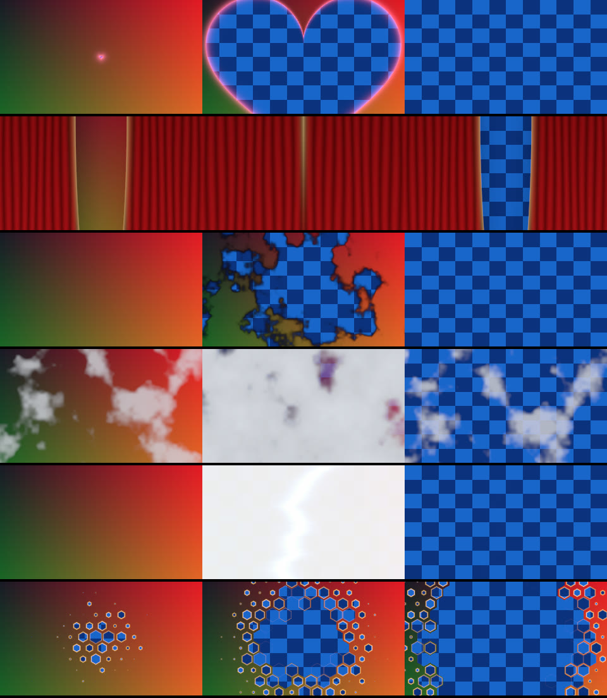

**En el DAW:** curva y tirador de volumen en cada audio, pistas con nombre y color, grupos plegables y clases con efectos compartidos en el Mixer (hasta 32 pistas), y la Playlist con el cristal y la relojería de Movie.

| Playlist con regla de reloj y curva de volumen | Mixer con grupos y clases |
|---|---|
| 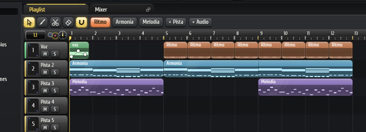 | 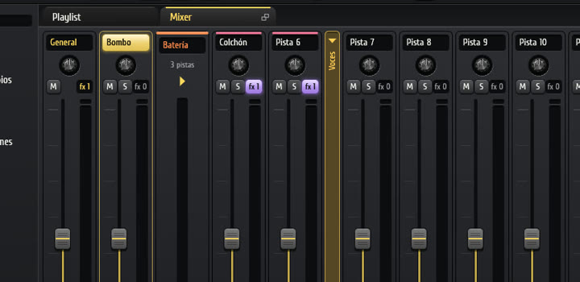 |

**Ventanas de plugins rediseñadas:** costados de madera, perillas con escala, bulbos que brillan con el sonido y carretes de aluminio con la cinta a la vista.

| Eco de cinta | Saturador de bulbos |
|---|---|
| 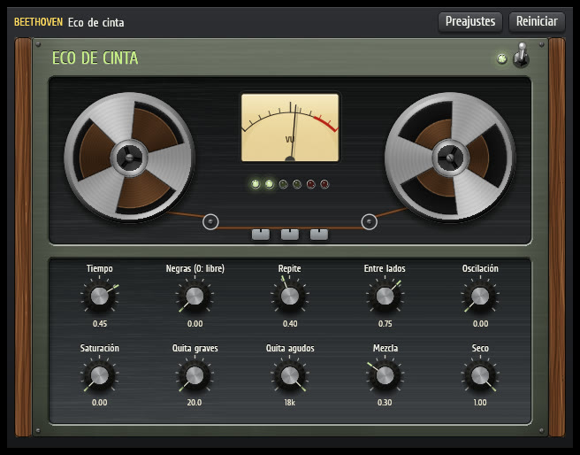 | 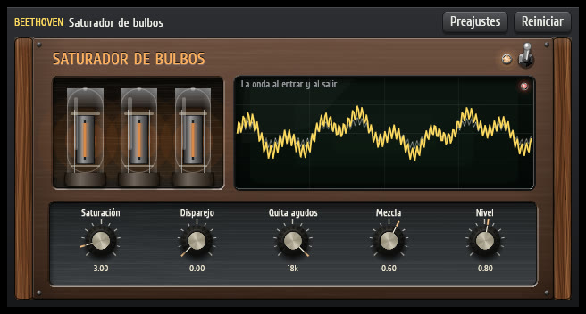 |

<details><summary>Más ventanas de plugins</summary>

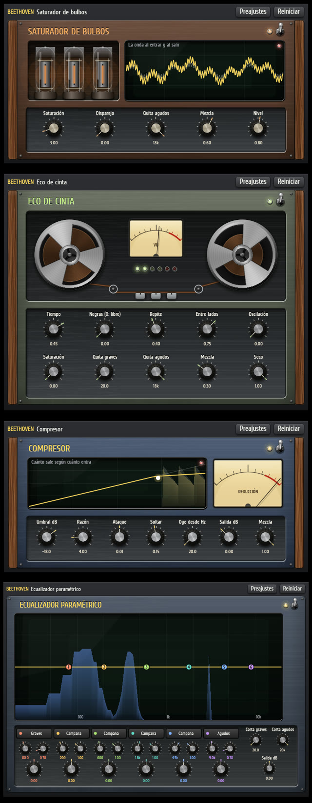
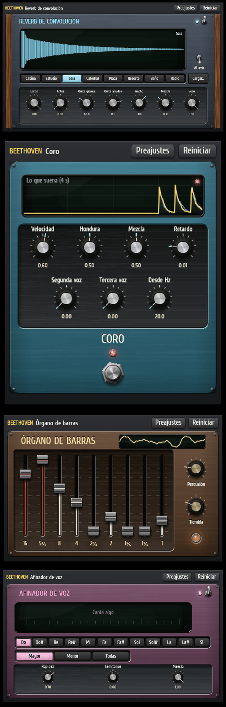

</details>

Todo lo nuevo, en las [notas de cada versión](https://github.com/Ismael-kaiser/beethoven-craft/releases).

## Beethoven Movie

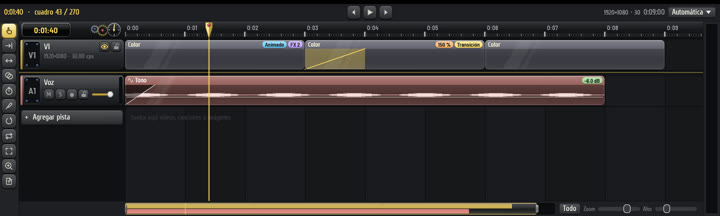

| Animación | Nodos y mezcla de color |
|---|---|
|  |  |

| Consola de audio | Archivos |
|---|---|
| 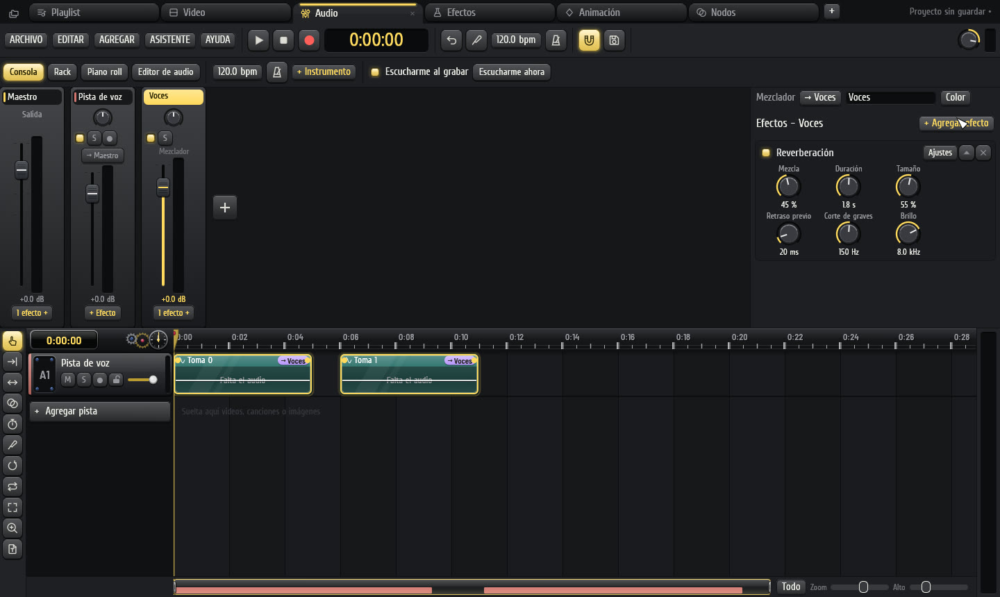 | 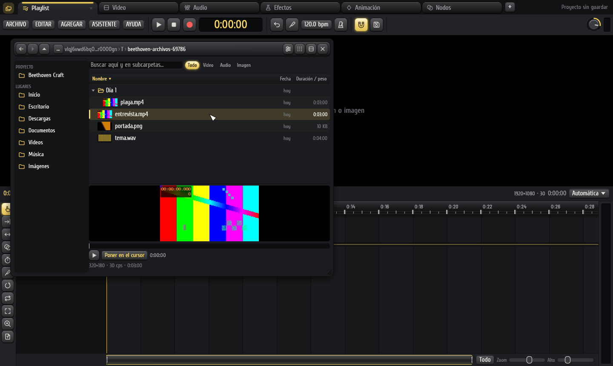 |

- Edición por pistas con cuchilla, recorte ondulado, rodar, estirar, deslizar y transiciones.
- **Animación libre**: llaves con clic derecho (posición, giro, escala, opacidad…), puntos con clic y caminos dibujados a mano.
- **Resolución y fotogramas** a elegir: horizontal, vertical, cuadrado o a la medida, de 1 a 120 cps.
- **Animación**: unas 40 animaciones listas, claves, gráfica de curvas y texto letra por letra.
- **Nodos**: efectos y color conectados como un grafo, con máscaras, calificadores y fusiones.
- **66 filtros** propios, ruedas de color, onda RGB, histograma y vectorscopio.
- **Panel de archivos**: carpetas, subcarpetas, búsqueda, miniaturas y vista previa; todo se arrastra a las pistas.
- **Clip vacío**: aplica efectos a todo lo que hay debajo, textos incluidos.
- **Audio** con ecualizador de siete bandas, vocoder, moldeador estéreo y más, y los plugins de Beethoven DAW.
- **Velocidad** de cualquier clip en el clic derecho, sola o junto con su sonido.
- **Exportar** a YouTube, TikTok, WhatsApp, Discord (sin pasar de 10 MB) o ProRes.
- Consola de audio, instrumentos, grabación y separador de voz en tu propia máquina.
- **Atajos de teclado** que se pueden cambiar todos.

Guía completa: [docs/movie.md](docs/movie.md)

## Beethoven DAW

El estudio de música, escrito desde cero para Beethoven Craft (carpeta `daw-demo/`, MIT o Apache-2.0).

- **La Playlist es el fondo**; el **Mixer** es otra pestaña o ventana; Ritmo, Piano roll e Instrumento son ventanas encima. Con el metal y el vidrio de Movie.
- **Pistas de audio** (WAV, MP3, OGG, FLAC, M4A, video…) con curva y tirador de volumen, editor de audio y grabación.
- **Mixer** de hasta 32 pistas con envíos, grupos plegables, clases con efectos compartidos, color y 48 efectos con ventana analógica.
- **Instrumentos grabados** nota por nota (banco MuseScore General, MIT), por familia: pianos, guitarras, cuerdas, orquesta, metales, maderas, coros, sintetizadores, baterías y percusión.
- **Crear en Lua**: tus propios instrumentos y efectos, con editor dentro de la app; cada uno puede traer su carpeta con imágenes PNG y su propio logo.
- **Plugins VST3 y CLAP**, SoundFont (.sf2 y .sf3), SFZ y audio suelto como instrumentos; teclados MIDI.
- **Abre `.flp`** y MIDI; exporta WAV, pistas separadas, MP3, FLAC, OGG y M4A.
- **Asistente de IA** que edita el proyecto (el mismo que en Movie).

Guía completa: [daw-demo/README.md](daw-demo/README.md)

## Instalar

Baja el paquete de tu sistema en [Releases](https://github.com/Ismael-kaiser/beethoven-craft/releases/latest). Desde la 0.11 la app avisa cuando hay una versión nueva y se actualiza sola (se puede apagar en Configuración).

- **Mac** (Apple Silicon): descomprime y arrastra «Beethoven Craft.app» a Aplicaciones. No está firmada por Apple: la primera vez ábrela con clic derecho → Abrir. Necesita ffmpeg (`brew install ffmpeg`).
- **Windows**: el instalador (`.exe`) o el `.zip` portátil; ya traen ffmpeg. No está firmado, así que Windows puede avisar: «Más información» → «Ejecutar de todas formas».
- **Linux**: descomprime el `.tar.gz` y abre `beethoven-craft`. Necesita ffmpeg (`sudo apt install ffmpeg`).

Si la app se cierra de golpe, al abrirla otra vez te ofrece recuperar tu trabajo. Si algo falla, queda anotado en `Beethoven Craft/Errores.log`.

**Para compilarlo** hace falta [Rust](https://rustup.rs) y `ffmpeg`.

```sh
git clone https://github.com/Ismael-kaiser/beethoven-craft.git
cd beethoven-craft

# Mac: deja «Beethoven Craft.app» en la carpeta
brew install ffmpeg
zsh empaque/empacar.sh

# Linux: deja beethoven-craft-linux.tar.gz
sudo apt install ffmpeg libasound2-dev pkg-config
sh empaque/empacar-linux.sh
```

```powershell
# Windows: deja un zip
powershell -ExecutionPolicy Bypass -File empaque\empacar-windows.ps1
```

La app se prueba en Mac (Apple Silicon). Los paquetes de Windows y Linux están preparados, pero se han probado menos. Más detalles en [docs/desarrollo.md](docs/desarrollo.md).

## Dónde quedan tus cosas

Grabaciones, voces separadas y autoguardado van en la carpeta de videos del usuario (`~/Movies`, `Videos` o `~/Videos`), dentro de `Beethoven Craft`. Los proyectos de video son `.bcraft`.

## Licencia y créditos

[MIT](LICENSE-MIT) o [Apache-2.0](LICENSE-APACHE), la que prefieras. Todo el código es propio.

Movie usa piezas de EffectCraft, FilmCraft y AniCraft, y el paquete de Windows trae ffmpeg, un programa aparte con su propia licencia. Todos los créditos están en [AVISOS.md](AVISOS.md).

Este proyecto no está afiliado a ArtCraft, FL Studio (Image-Line), DaVinci Resolve (Blackmagic Design) ni CapCut.
