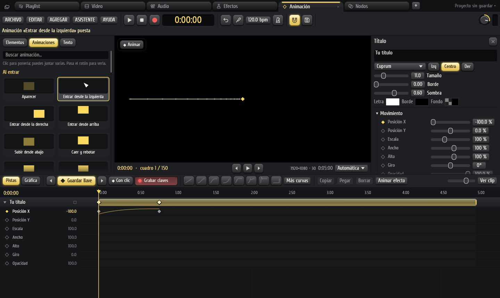
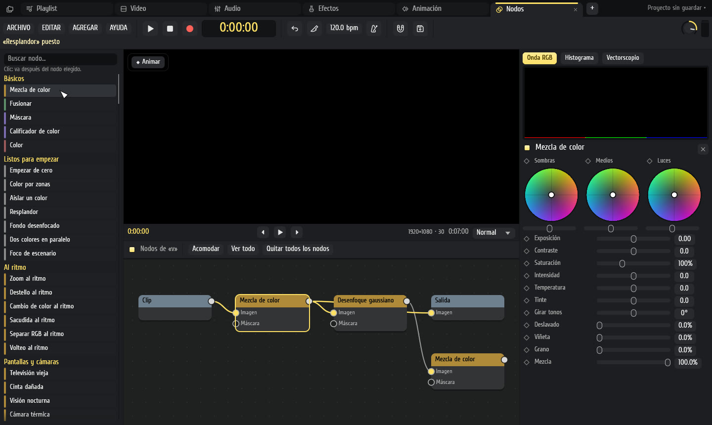
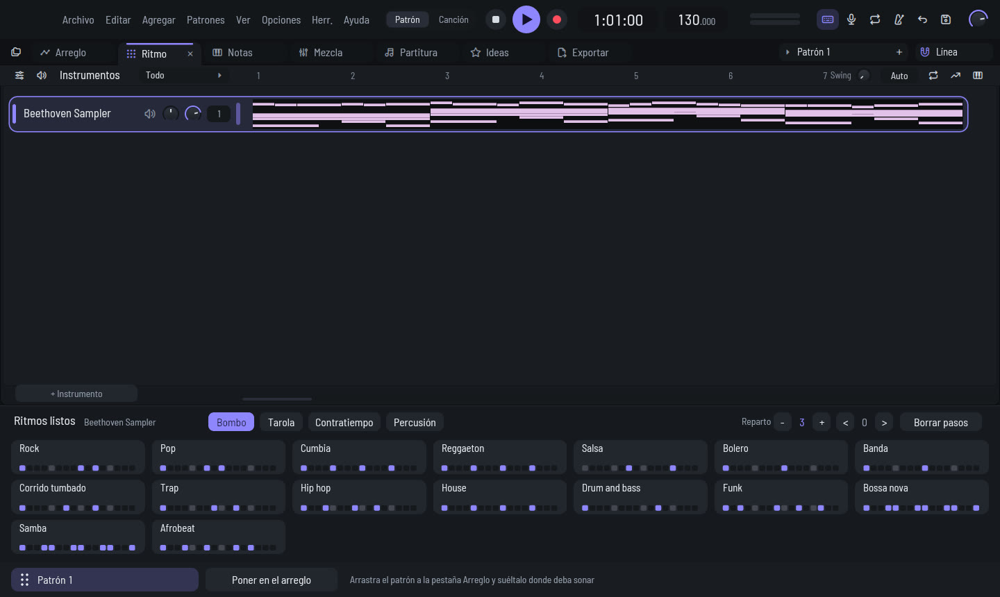

# Beethoven Craft

Compositor de video y audio en español (y en inglés), hecho en Rust. Son dos programas en una app:

- **Beethoven Movie**: editor de video con animación, nodos, filtros y mezcla de sonido.
- **Beethoven DAW**: estudio de música con partitura editable, ritmos, ideas, piano roll y plugins VST/CLAP.

Creado por **mixter-ha99**. Software libre, GPL-3.0 o posterior.

> *English: a free video editor (Beethoven Movie) and music studio (Beethoven DAW) in one app, written in Rust. The interface is available in Spanish and English. Docs are in Spanish for now.*


## Beethoven Movie

| Animación | Nodos y mezcla de color |
|---|---|
|  |  |

- Edición por pistas con cuchilla, recorte ondulado, rodar, estirar, deslizar y transiciones.
- **Animación**: unas 40 animaciones listas, claves, gráfica de curvas y texto letra por letra.
- **Nodos**: efectos y color conectados como un grafo, con máscaras, calificadores y fusiones.
- **66 filtros** propios, ruedas de color, onda RGB, histograma y vectorscopio.
- **Clip vacío**: aplica efectos a todo lo que hay debajo, textos incluidos.
- Consola de audio, instrumentos, grabación y separador de voz en tu propia máquina.
- **Atajos de teclado** que se pueden cambiar todos.

Guía completa: [docs/movie.md](docs/movie.md)

## Beethoven DAW

| Partitura | Ritmo |
|---|---|
|  |  |
| **Ideas** | **Notas** |
|  |  |

- Todo en pestañas, como un navegador: Arreglo, Ritmo, Notas, Mezcla, Partitura, Ideas y Exportar.
- **Partitura**: se compone pintando notas en el pentagrama; es la misma música que el piano roll.
- **Ritmo**: 16 ritmos listos (rock, cumbia, reggaeton, banda, corrido tumbado, trap…).
- **Ideas**: acordes, progresiones por ánimo y generadores de bajo, arpegio, melodía y segunda voz.
- Plugins **CLAP, VST3 y VST2**. Exporta WAV, FLAC, MP3, OGG, MIDI y MusicXML.

Guía completa: [docs/daw.md](docs/daw.md)

## Instalar

No hay descargas listas todavía: se compila. Hace falta [Rust](https://rustup.rs) y `ffmpeg`.

```sh
git clone https://github.com/Ismael-kaiser/beethoven-craft.git
cd beethoven-craft

# Mac: deja «Beethoven Craft.app» en la carpeta
brew install ffmpeg
zsh empaque/empacar.sh

# Linux: deja beethoven-craft-linux.tar.gz
sudo apt install ffmpeg libasound2-dev pkg-config
sh empaque/empacar-linux.sh
```

```powershell
# Windows: deja un zip
powershell -ExecutionPolicy Bypass -File empaque\empacar-windows.ps1
```

La app se prueba en Mac (Apple Silicon). Los paquetes de Windows y Linux están preparados, pero se han probado menos. Más detalles en [docs/desarrollo.md](docs/desarrollo.md).

## Dónde quedan tus cosas

Grabaciones, voces separadas y autoguardado van en la carpeta de videos del usuario (`~/Movies`, `Videos` o `~/Videos`), dentro de `Beethoven Craft`. Los proyectos de video son `.bcraft`.

## Licencia y créditos

GPL-3.0 o posterior (`LICENSE`). Beethoven DAW es una versión modificada de [Lemon Studio](https://github.com/ItsAlphaNeon/Lemon-Studio), y Movie usa piezas de EffectCraft, FilmCraft y AniCraft. Todos los créditos y licencias están en [AVISOS.md](AVISOS.md).

Este proyecto no está afiliado a Lemon Studio, ArtCraft, FL Studio (Image-Line), DaVinci Resolve (Blackmagic Design) ni CapCut.
