# Beethoven Craft

Compositor de video y audio en español (y en inglés), hecho en Rust. Son dos programas en una app:

- **Beethoven Movie**: editor de video con animación, nodos, filtros y mezcla de sonido.
- **Beethoven DAW**: estudio de música con partitura editable, ritmos, ideas, piano roll y plugins VST/CLAP.

Creado por **mixter-ha99**. Software libre, GPL-3.0 o posterior.

> *English: a free video editor (Beethoven Movie) and music studio (Beethoven DAW) in one app, written in Rust. The interface is available in Spanish and English. Docs are in Spanish for now.*

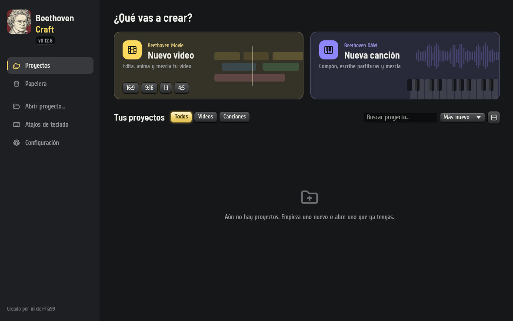

## Novedades de la 0.11

**Interfaz de metal y línea de tiempo nueva.** Botones, perillas y faders con relieve; clips de cristal con etiquetas (efectos, animación, transición, velocidad); regla profesional, cursor con cabeza de metal y minimapa para hacer zoom.

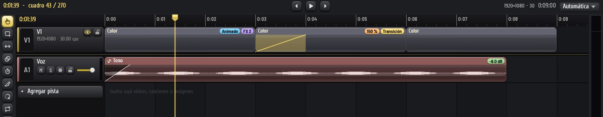

| Volumen dentro de cada clip de audio | Perillas y mezclador de metal |
|---|---|
| 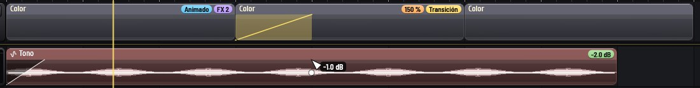 | 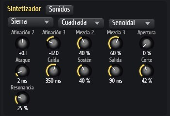 |

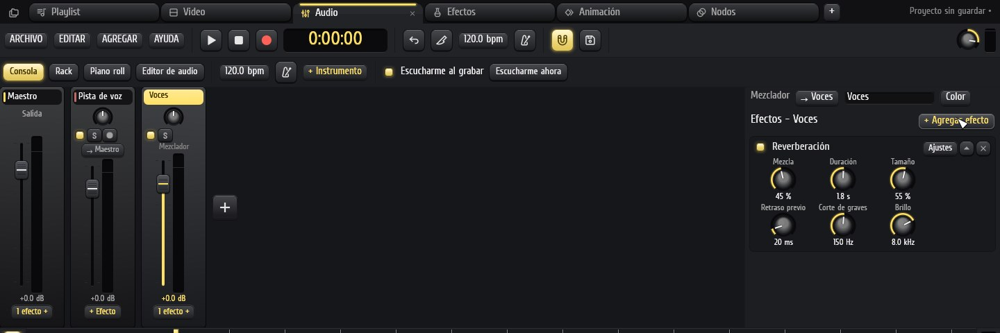

| Biblioteca con vista previa | Apartado Texto | Agregar una fuente |
|---|---|---|
| 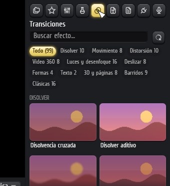 | 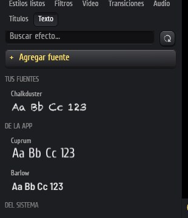 | 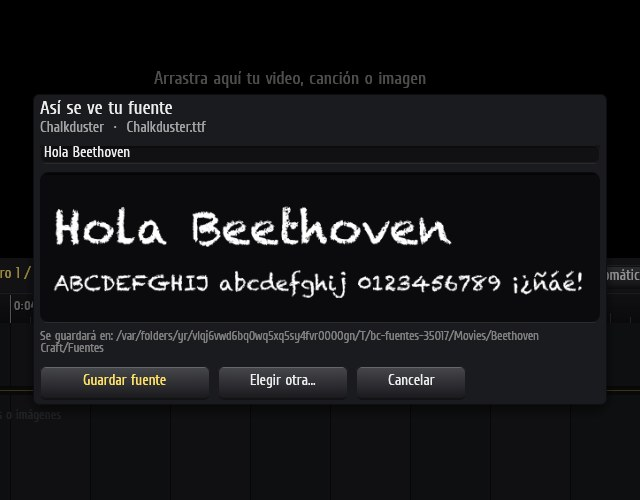 |

| Mover, escalar, estirar y girar en la vista previa | Ventana de exportación |
|---|---|
| 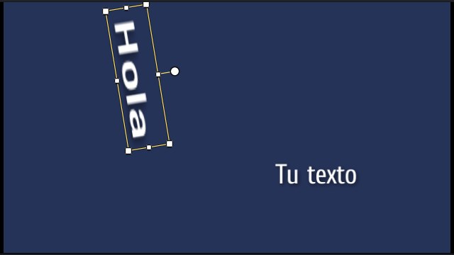 | 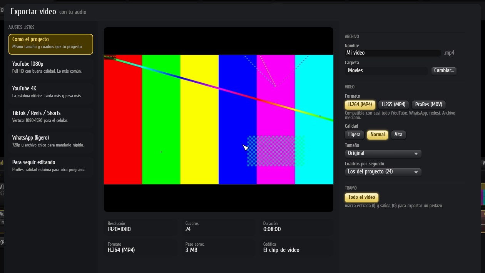 |

| Videos que tu computadora no lee bien | Explorador de archivos |
|---|---|
| 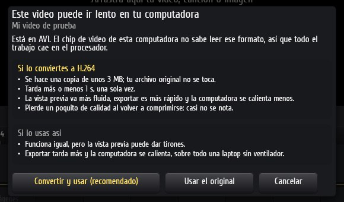 | 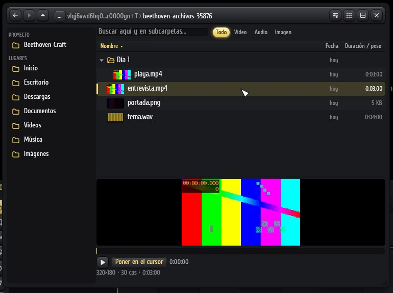 |

**Sin tirones:** en pausa se preparan las transiciones pesadas; la barra verde de la regla marca lo que ya se verá fluido.

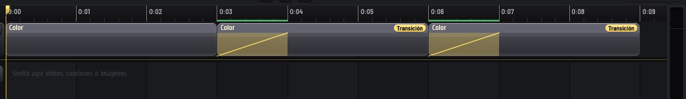

| Recuperación si la app se cierra de golpe | Actualizaciones automáticas |
|---|---|
| 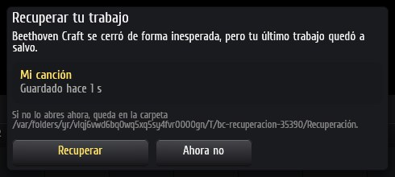 | 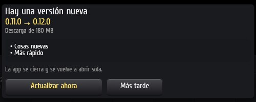 |

Todo lo nuevo, en las [notas de la versión](https://github.com/Ismael-kaiser/beethoven-craft/releases/tag/v0.11.0).

## Beethoven Movie

| Animación | Nodos y mezcla de color |
|---|---|
|  |  |

- Edición por pistas con cuchilla, recorte ondulado, rodar, estirar, deslizar y transiciones.
- **Animación libre**: llaves con clic derecho (posición, giro, escala, opacidad…), puntos con clic y caminos dibujados a mano.
- **Resolución y fotogramas** a elegir: horizontal, vertical, cuadrado o a la medida, de 1 a 120 cps.
- **Animación**: unas 40 animaciones listas, claves, gráfica de curvas y texto letra por letra.
- **Nodos**: efectos y color conectados como un grafo, con máscaras, calificadores y fusiones.
- **66 filtros** propios, ruedas de color, onda RGB, histograma y vectorscopio.
- **Panel de archivos**: carpetas, subcarpetas, búsqueda, miniaturas y vista previa; todo se arrastra a las pistas.
- **Clip vacío**: aplica efectos a todo lo que hay debajo, textos incluidos.
- **Audio** con los plugins de Beethoven DAW: ecualizador de siete bandas, vocoder, moldeador estéreo y más.
- Consola de audio, instrumentos, grabación y separador de voz en tu propia máquina.
- **Atajos de teclado** que se pueden cambiar todos.

Guía completa: [docs/movie.md](docs/movie.md)

## Beethoven DAW

| Partitura | Ritmo |
|---|---|
| 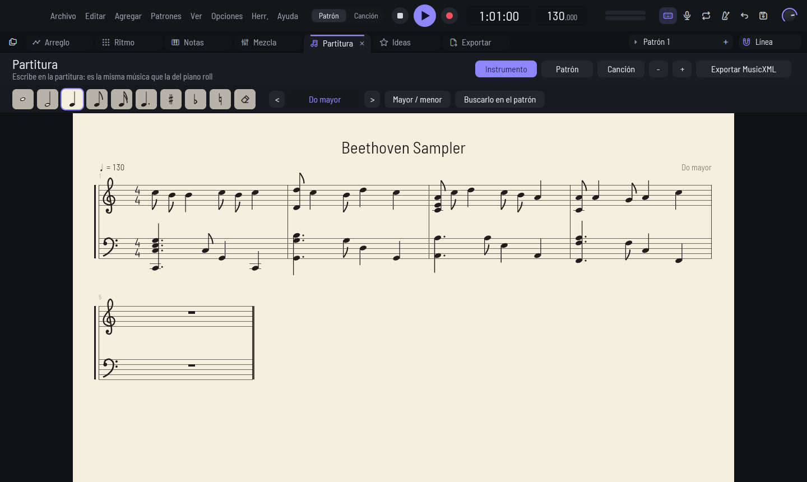 |  |
| **Ideas** | **Notas** |
|  |  |

- Todo en pestañas, como un navegador: Arreglo, Ritmo, Notas, Mezcla, Partitura, Ideas y Exportar.
- **Partitura**: se compone pintando notas en el pentagrama; es la misma música que el piano roll.
- **Ritmo**: 16 ritmos listos (rock, cumbia, reggaeton, banda, corrido tumbado, trap…).
- **Ideas**: acordes, progresiones por ánimo y generadores de bajo, arpegio, melodía y segunda voz.
- Plugins **CLAP, VST3 y VST2**. Exporta WAV, FLAC, MP3, OGG, MIDI y MusicXML.

Guía completa: [docs/daw.md](docs/daw.md)

## Instalar

Baja el paquete de tu sistema en [Releases](https://github.com/Ismael-kaiser/beethoven-craft/releases/latest). Desde la 0.11 la app avisa cuando hay una versión nueva y se actualiza sola (se puede apagar en Configuración).

- **Mac** (Apple Silicon): descomprime y arrastra «Beethoven Craft.app» a Aplicaciones. No está firmada por Apple: la primera vez ábrela con clic derecho → Abrir. Necesita ffmpeg (`brew install ffmpeg`).
- **Windows**: el instalador (`.exe`) o el `.zip` portátil; ya traen ffmpeg. No está firmado, así que Windows puede avisar: «Más información» → «Ejecutar de todas formas».
- **Linux**: descomprime el `.tar.gz` y abre `beethoven-craft`. Necesita ffmpeg (`sudo apt install ffmpeg`).

Si la app se cierra de golpe, al abrirla otra vez te ofrece recuperar tu trabajo. Si algo falla, queda anotado en `Beethoven Craft/Errores.log`.

**Para compilarlo** hace falta [Rust](https://rustup.rs) y `ffmpeg`.

```sh
git clone https://github.com/Ismael-kaiser/beethoven-craft.git
cd beethoven-craft

# Mac: deja «Beethoven Craft.app» en la carpeta
brew install ffmpeg
zsh empaque/empacar.sh

# Linux: deja beethoven-craft-linux.tar.gz
sudo apt install ffmpeg libasound2-dev pkg-config
sh empaque/empacar-linux.sh
```

```powershell
# Windows: deja un zip
powershell -ExecutionPolicy Bypass -File empaque\empacar-windows.ps1
```

La app se prueba en Mac (Apple Silicon). Los paquetes de Windows y Linux están preparados, pero se han probado menos. Más detalles en [docs/desarrollo.md](docs/desarrollo.md).

## Dónde quedan tus cosas

Grabaciones, voces separadas y autoguardado van en la carpeta de videos del usuario (`~/Movies`, `Videos` o `~/Videos`), dentro de `Beethoven Craft`. Los proyectos de video son `.bcraft`.

## Licencia y créditos

- **El código propio de Beethoven Craft**: [MIT](LICENSE-MIT) o [Apache-2.0](LICENSE-APACHE), la que prefieras.
- **Lo que viene de Lemon Studio** (`daw/`, `crates/audio-fx`, y los archivos de Movie que dice [AVISOS.md](AVISOS.md)): [GPL-3.0 o posterior](LICENSE), como lo puso su autor.
- **La app completa**, porque incluye esas piezas, se reparte bajo GPL-3.0 o posterior.

Beethoven DAW es una versión modificada de [Lemon Studio](https://github.com/ItsAlphaNeon/Lemon-Studio), y Movie usa piezas de EffectCraft, FilmCraft y AniCraft. Todos los créditos y licencias están en [AVISOS.md](AVISOS.md).

Este proyecto no está afiliado a Lemon Studio, ArtCraft, FL Studio (Image-Line), DaVinci Resolve (Blackmagic Design) ni CapCut.
