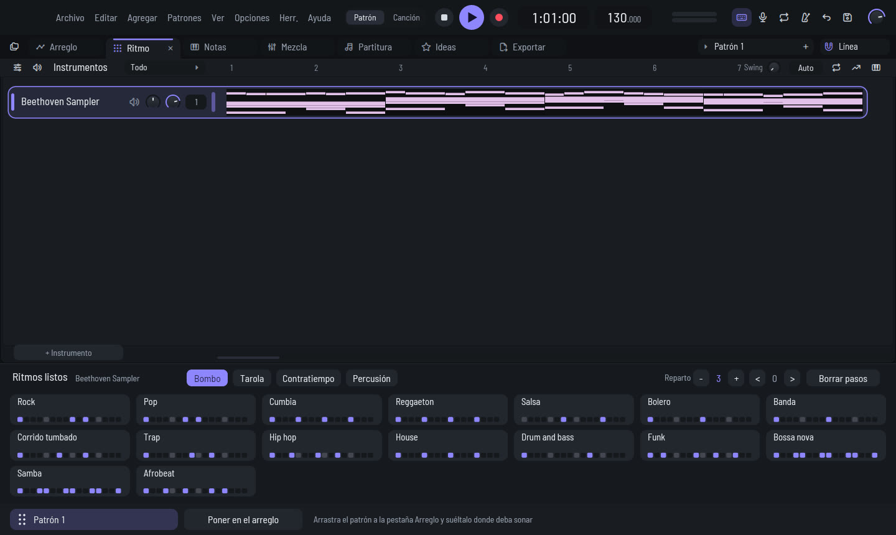
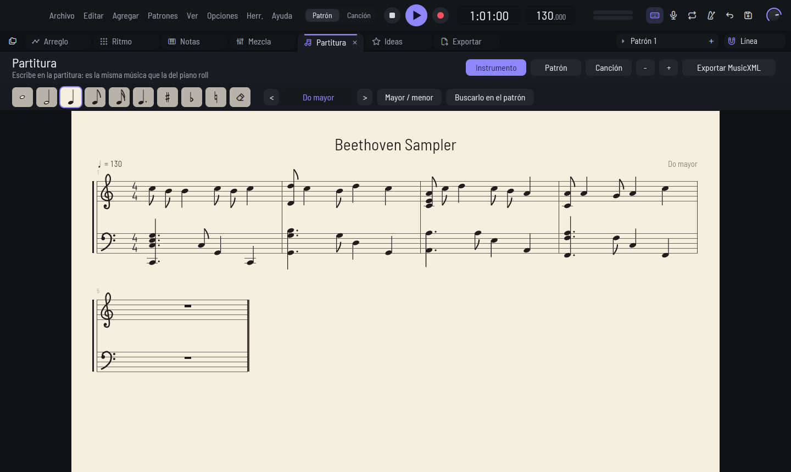
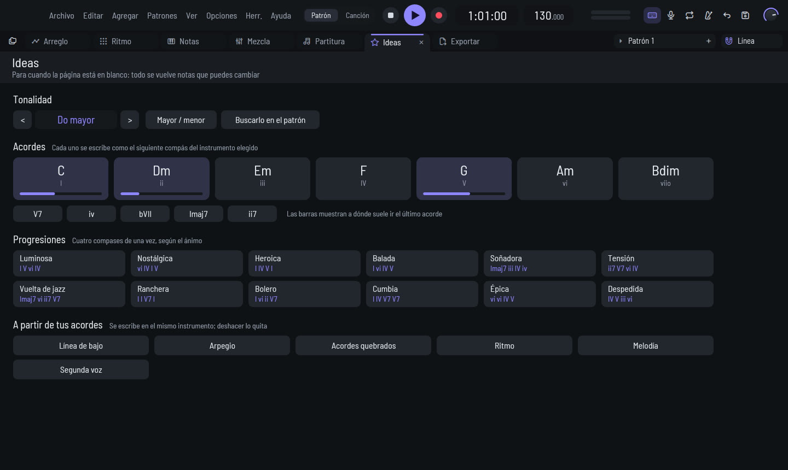
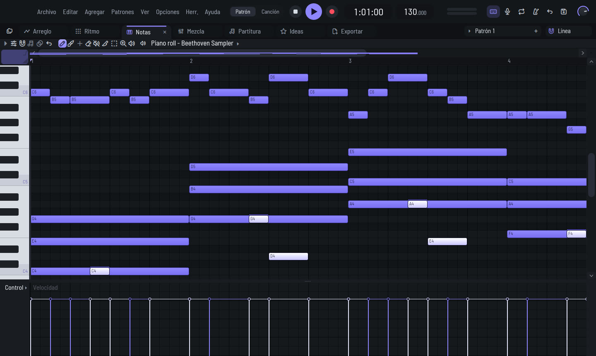
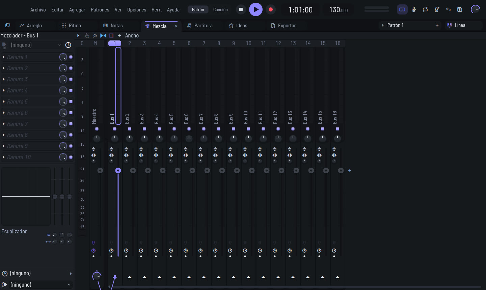

# Beethoven DAW: guía

El estudio de música. Se abre desde el menú de Beethoven Craft con **Nueva canción**.

Las pestañas se abren, se cierran y se cambian como en un navegador.

## Cómo hacer una canción

1. En **Ritmo**, elige un instrumento, toca los pasos o pon uno de los **ritmos listos**.
2. En **Notas** o en **Partitura**, escribe la melodía.
3. En **Ideas**, deja que te sugiera acordes, bajo o una segunda voz.
4. Lleva cada patrón al **Arreglo** y ordénalos en el tiempo.
5. Ajusta niveles y efectos en **Mezcla** y saca la canción en **Exportar**.

## Ritmo

Cada renglón es un instrumento. **Ritmos listos** escribe un ritmo en el instrumento elegido; primero escoge qué parte toca (bombo, tarola, contratiempo o percusión). **Reparto** distribuye golpes lo más parejo posible y los gira.

### Llevar el ritmo al arreglo

Abajo está el patrón con seis puntitos. **Arrástralo hasta la pestaña Arreglo** (se abre sola) y suéltalo en la pista y el compás que quieras. Con **Poner en el arreglo** se agrega solo, después de su último clip.

## Partitura

Con **Instrumento** elegido se escribe; **Patrón** y **Canción** muestran todo.

| Para | Haz esto |
|---|---|
| Escribir una nota | Elige la figura y haz clic en el pentagrama |
| Pintar varias | Clic y arrastra a la derecha |
| Mover una nota | Arrástrala |
| Cambiarle la figura o la alteración | Escoge la nueva y haz clic en la nota |
| Borrar | Clic derecho, o el borrador |
| Cambiar la tonalidad | `<` `>` y «Mayor / menor», o «Buscarlo en el patrón» |
| Hacerla más grande o más chica | `+` y `-`, o Ctrl y la rueda del ratón |

Los silencios y las ligaduras se ponen solos. Es la misma música que el piano roll y se deshace igual. La cuadrícula es de semicorcheas; lo que no cae en ella se ve redondeado en la partitura, pero suena igual.

## Ideas

Los acordes de la tonalidad, con barras que muestran a dónde suele ir el último; progresiones de cuatro compases por ánimo; y, a partir de tus acordes, bajo, arpegio, ritmo, melodía y segunda voz. Todo se escribe como notas que puedes cambiar.

## Notas y Mezcla

El piano roll del instrumento elegido, con la fuerza de cada nota abajo.

Los efectos del bus elegido a la izquierda; los buses, a la derecha.

## Exportar

Audio (WAV, FLAC, OGG, MP3, con pistas separadas), MIDI y **MusicXML**, que abren MuseScore, Sibelius, Finale y Dorico.

## Plugins

Carga **CLAP, VST3 y VST2**. Trae sus propios instrumentos y efectos. No carga Audio Units ni los plugins internos de FL Studio, que son de formato cerrado. Abre proyectos `.flp`.
