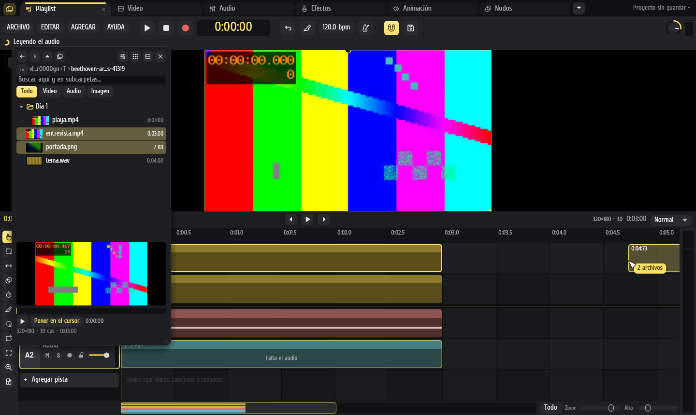
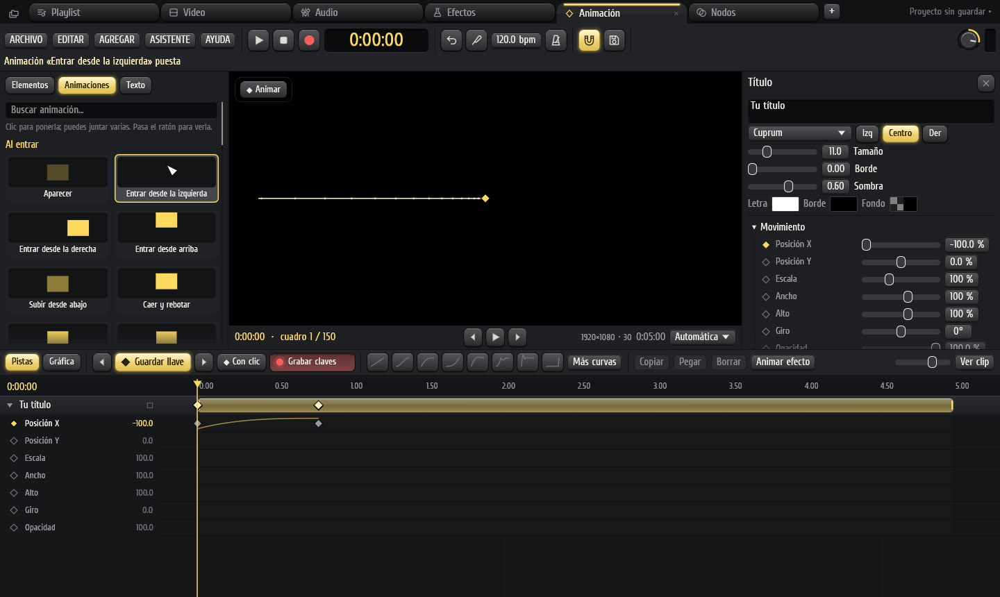
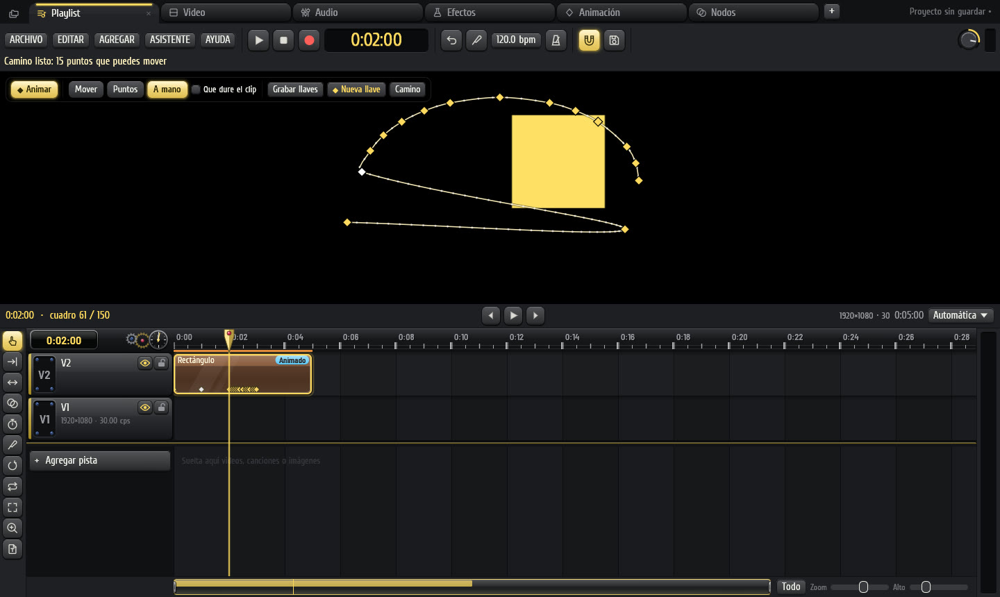
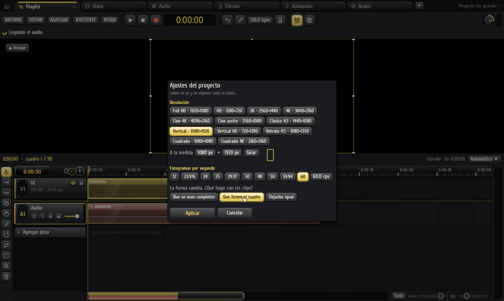
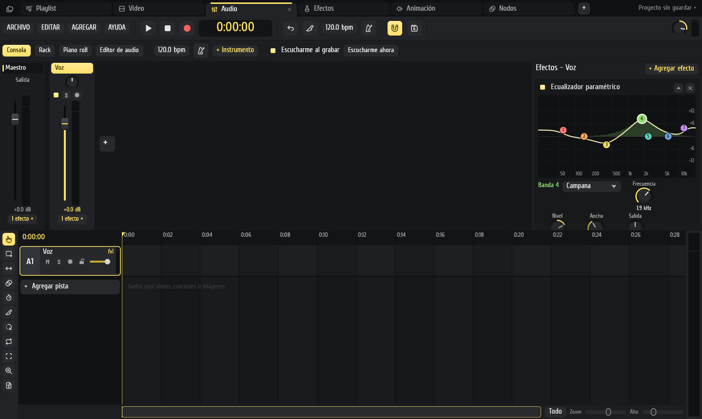
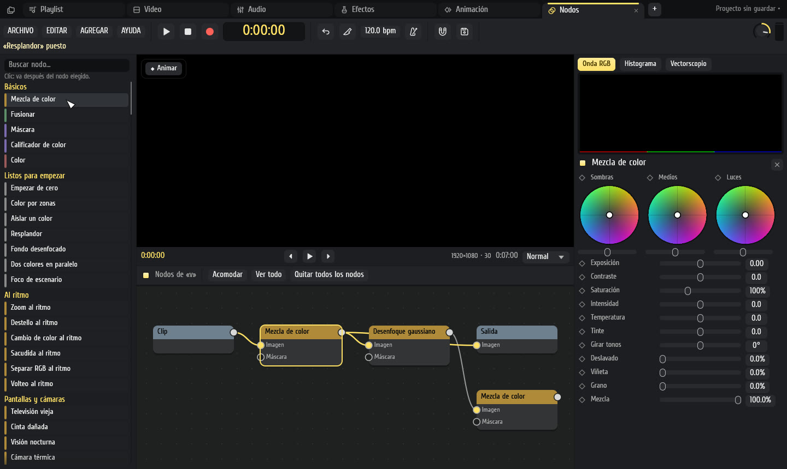
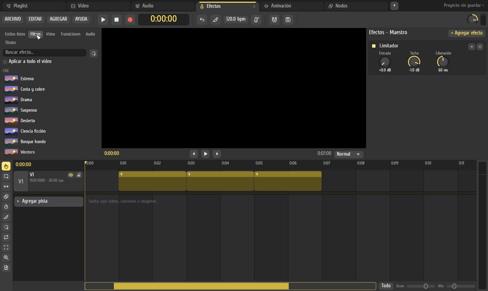

# Beethoven Movie: guía

El editor de video. Se abre desde el menú con **Nuevo video**.

Las pestañas se cierran, se ordenan arrastrando, `+` abre otra y con clic derecho se sacan a su propia ventana.

## Pestañas

- **Playlist**: el resultado final con todas las pistas.
- **Video**: origen, controles y color a la izquierda; programa al centro; biblioteca a la derecha; herramientas, pistas y medidor abajo.
- **Audio**: consola, rack, piano roll y editor. En Rack y Piano roll, la columna de la izquierda elige el instrumento; «Suena» le cambia el sonido sin tocar las notas.
- **Efectos**: catálogo con muestras (estilos, filtros, video, transiciones, audio y títulos), vista previa y los controles de lo elegido.
- **Animación**: ver abajo.
- **Nodos**: ver abajo.

## Primer video

1. Arrastra tus videos, canciones o imágenes a la línea de tiempo, o usa **⌘I**.
2. Corta con **S** o la cuchilla (**C**). **Q** y **W** recortan el principio o el final hasta el cursor.
3. Pon textos con **⌘T** y efectos desde la biblioteca.
4. Exporta con **⌘M**. Si un video no cambió, se copia sin recodificar; en Mac se usa el codificador del equipo.

La imagen y el sonido de un video quedan vinculados; clic derecho para desvincular. La automatización está en el clic derecho de la cabecera de la pista.

## Panel de archivos

Es una ventana flotante: se mueve de donde no hay botones, se estira de las orillas y con su botón se pega a la izquierda. Se abre y se cierra con el botón de carpetas de arriba a la izquierda o con **⌘B**. Está en todas las pestañas.

- La flecha de una carpeta la abre ahí mismo; doble clic entra en ella. Arriba se ve el camino y cada parte se puede tocar.
- El buscador busca también en las subcarpetas. Se puede filtrar por video, audio o imagen, ordenar y ver como cuadrícula.
- Un clic muestra el archivo abajo: pasa el ratón por la imagen para recorrerlo o dale reproducir.
- Se arrastra a una pista, a la vista previa o al espacio vacío. Con ⌘ o Shift se eligen varios y quedan uno tras otro. Doble clic lo pone en el cursor.
- Clic derecho: favoritos, abrir en Origen, mostrarlo en el sistema. El panel nunca borra, mueve ni cambia tus archivos.

## Animación

- **Elementos**: figuras, textos e imágenes para animar.
- **Animaciones**: de entrada, de salida, de énfasis y «todo el tiempo». Un clic pone la animación sobre el clip elegido y se pueden juntar varias.
- **Texto**: animación letra por letra, por palabra o por línea.
- **Pistas**: los cuadros clave de cada propiedad. **Gráfica**: la curva, con manijas.
- **Grabar claves**: con el botón encendido, mover el cuadro en la pantalla crea las claves.

## Animación libre

Elige un clip y abre **◆ Animar**, arriba a la izquierda de la imagen. Está en todas las pestañas.

- **Poner una llave**: clic derecho en la imagen o en el clip de la línea de tiempo → «Poner llave de…» posición, giro, escala, ancho y alto, opacidad o todo. Guarda el valor que tiene en ese momento; después mueve el cursor, cambia el valor y la siguiente se guarda sola.
- **Mover las llaves**: los rombos del clip elegido se arrastran en la línea de tiempo. Cada tipo tiene su color. Clic derecho: cambiar su curva o quitarla.
- **Puntos**: cada clic en la imagen es una posición y el cursor avanza lo que diga «cada». Los puntos se arrastran.
- **A mano**: dibuja el camino con el ratón y el clip lo recorre a la misma velocidad. Con «Que dure el clip» se reparte en lo que le queda.
- **Grabar llaves**: cualquier cambio pone su llave.
- **Camino**: curvo o recto, velocidad pareja, girar con el camino, al revés o borrarlo. Las marcas juntas son lento; separadas, rápido.

## Ajustes del proyecto

**⌘⇧P**, o el tamaño que sale debajo de la imagen. Cambia la resolución (12 formatos o a la medida) y los fotogramas por segundo, y decide qué hacer con los clips si cambia la forma. En el menú de un clip, «Acomodar en el cuadro» lo deja completo, llenando o estirado. Al exportar se puede escoger otro tamaño y otros fotogramas.

## Audio

«+ Agregar efecto» tiene los efectos por grupo. El grupo **Beethoven DAW** trae el ecualizador paramétrico (los puntos se arrastran sobre la curva, la rueda cambia el ancho), distorsión, moldeador estéreo, vocoder y balance.

## Nodos

Los efectos de un clip se conectan en lugar de ir en lista. Cada nodo tiene entrada de imagen y, si la usa, de máscara. Hay fusión, máscara, calificador de color, mezcla de color con ruedas, plantillas para empezar y todos los efectos de video. El grafo se aplica después de los efectos normales del clip.

## Clip vacío

**⌘⇧A**, o «Clip vacío» en la biblioteca. No tiene imagen: sus efectos se aplican a todo lo que hay debajo, incluidos los textos.

## Filtros

Son 66 y todos son puntos de partida de «Mezcla de color»: después de ponerlos se pueden ajustar.

## Efectos y estilos propios

Además de los efectos de EffectCraft y FilmCraft, Movie trae 76 hechos para este proyecto, por grupo: Al ritmo, Pantallas y cámaras, Adornos, Cómic y color, Espejos y ondas, Elegantes, Movimiento y pulso, 3D y lentes, Luces, Fiesta y naturaleza, Terror, Marcos y aperturas, Retro y dibujo. Los **estilos** juntan varios con sus valores. Todos sus controles se pueden animar.

## Proyecto

`.bcraft` es un binario propio, comprimido y con suma de control. «Guardar con todo incluido» mete también los videos y audios. Los proyectos viejos en JSON se siguen abriendo.

## Atajos de teclado

Se cambian en **Atajos de teclado…** (⌘⌥K). En Windows y Linux, ⌘ es Ctrl. Estos son los de fábrica:

### Proyecto

| Acción | Teclas |
|---|---|
| Guardar | ⌘+S |
| Guardar como… | ⌘+Shift+S |
| Abrir proyecto… | ⌘+O |
| Importar video o audio… | ⌘+I |
| Exportar video con mi audio… | ⌘+M |
| Ajustes del proyecto… | ⌘+Shift+P |
| Menú principal | (sin tecla) |
| Atajos de teclado… | ⌘+Alt+K |

### Reproducción

| Acción | Teclas |
|---|---|
| Reproducir / pausa | Espacio |
| Pausa | K |
| Reproducir | L |
| Regresar 5 segundos | J |
| Detener y volver al inicio | Shift+Espacio |
| Grabar | R |
| Un cuadro atrás | ← |
| Un cuadro adelante | → |
| Cinco cuadros atrás | Shift+← |
| Cinco cuadros adelante | Shift+→ |
| Corte anterior | ↑ |
| Corte siguiente | ↓ |
| Ir al inicio | Inicio |
| Ir al final | Fin |

### Edición

| Acción | Teclas |
|---|---|
| Deshacer | ⌘+Z |
| Rehacer | ⌘+Shift+Z |
| Dividir en el cursor | S o ⌘+K |
| Borrar clip | ⌫ o Supr |
| Borrar y cerrar hueco | Shift+⌫ o Shift+Supr |
| Elegir todo | ⌘+A |
| Elegir el clip del cursor | D |
| Recortar el principio al cursor | Q |
| Recortar el final al cursor | W |
| Transición rápida | ⌘+D |
| Poner marca | M |
| Principio del tramo | I |
| Final del tramo | O |
| Quitar el tramo | Alt+X |
| Levantar el tramo | ; |
| Extraer el tramo | ' |
| Clip vacío (efectos para todo) | ⌘+Shift+A |
| Poner un texto | ⌘+T |

### Herramientas

| Acción | Teclas |
|---|---|
| Selección | V |
| Selección hacia adelante | A |
| Recorte ondulado | B |
| Rodar | N |
| Estirar | X |
| Cuchilla | C |
| Deslizar | Y |
| Correr | U |
| Mano | H |
| Lupa | Z |
| Texto | T |

### Vista

| Acción | Teclas |
|---|---|
| Acercar | + o = |
| Alejar | - |
| Ver todo el proyecto | `\` |
| Imán | Shift+S |
| Panel de archivos | ⌘+B |
| Pestaña Playlist | ⌘+1 |
| Pestaña Video | ⌘+2 |
| Pestaña Audio | ⌘+3 |
| Pestaña Efectos | ⌘+4 |
| Pestaña Animación | ⌘+5 |
| Pestaña Nodos | ⌘+6 |

### Animación

| Acción | Teclas |
|---|---|
| Animar el clip elegido | Shift+A |
| Poner cuadro clave | Shift+K |
| Cuadro clave anterior | Shift+J |
| Cuadro clave siguiente | Shift+L |
| Grabar cuadros clave | Shift+R |
| Copiar cuadros clave | ⌘+C |
| Pegar cuadros clave | ⌘+V |
